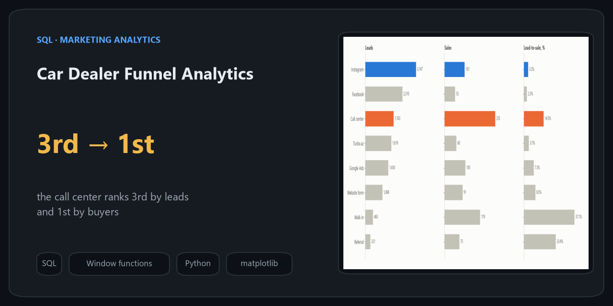
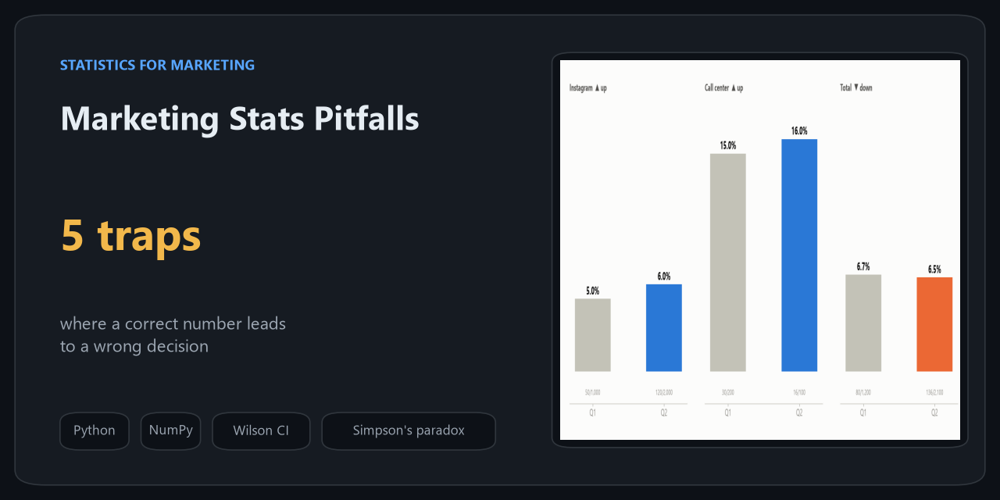
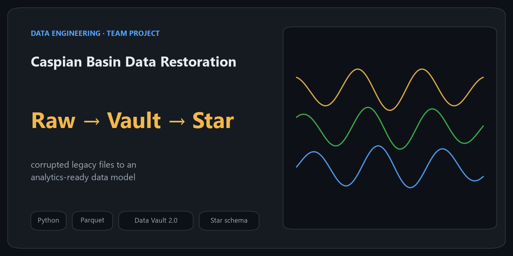
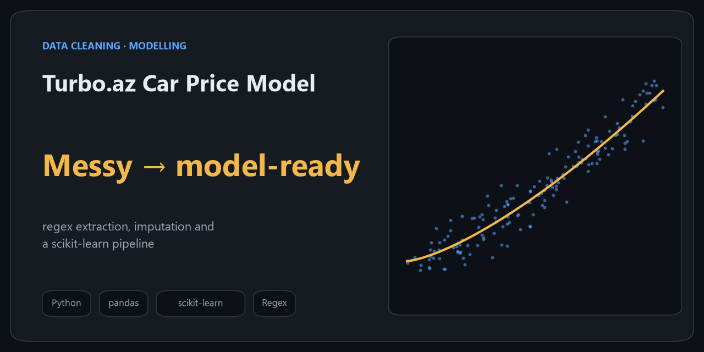

<picture>
  <source media="(prefers-color-scheme: dark)" srcset="assets/banner-dark.svg">
  
</picture>

  
  
  

I'm a data analyst working with marketing and sales data for 7 automotive brands at SR Group, Baku.

- **What I answer:** where customers drop out between the first message and the sale, which channels bring buyers and not just leads, how market share moves, and whether stock meets target.
- **What I build:** the pipelines behind the reports. My main project moves data from Google Sheets to a server and a real-time web dashboard that refreshes every 15 minutes.
- **How I check:** like-for-like comparisons, confidence intervals and a look at the denominator before a number goes into a decision.

## Tools

<picture>
  <source media="(prefers-color-scheme: dark)" srcset="assets/stack-dark.svg">
  
</picture>

## Projects

<table>
  <tr>
    <td width="50%" valign="top">
      
      <b><a href="https://github.com/kazimovmirkazim/az-new-car-market">Azerbaijan New-Car Market</a></b> 
      2,792 real Turbo.az listings. Market structure, official vs other dealers compared like-for-like with bootstrap CIs and permutation tests, price dispersion, paid promotion by seller type.
    </td>
    <td width="50%" valign="top">
      
      <b><a href="https://github.com/kazimovmirkazim/sheets-to-web-dashboard">Sheets to Web Dashboard</a></b> 
      An open, simplified version of the dashboard platform I run at work: Apps Script sync with hash-based change detection, gzip chunked upload, atomic table swap, mobile layout.
    </td>
  </tr>
  <tr>
    <td width="50%" valign="top">
      
      <b><a href="https://github.com/kazimovmirkazim/car-dealer-funnel-analytics">Car Dealer Funnel Analytics</a></b> 
      Lead-to-sale funnel, channel volume vs conversion, duplicate leads, market share in pp vs %, stock vs target. SQL with CTEs and window functions.
    </td>
    <td width="50%" valign="top">
      
      <b><a href="https://github.com/kazimovmirkazim/marketing-stats-pitfalls">Marketing Stats Pitfalls</a></b> 
      Percent vs points, small samples, Simpson's paradox, mean vs median, campaign vs season: one chart and one working rule each.
    </td>
  </tr>
  <tr>
    <td width="50%" valign="top">
      
      <b><a href="https://github.com/kazimovmirkazim/Caspian-Sea-Seismic-data-recovery">Caspian Basin Data Restoration</a></b> 
      Team project: corrupted legacy seismic files recovered into a Data Vault 2.0 model and a star schema for analytics.
    </td>
    <td width="50%" valign="top">
      
      <b><a href="https://github.com/kazimovmirkazim/Azerbaijani-car-dataset-Turboaz-dataset">Turbo.az Car Price Model</a></b> 
      Cleaning messy Azerbaijani car listings with regex and imputation, then a price model in a scikit-learn pipeline.
    </td>
  </tr>
</table>

Project data is either public (aggregated) or synthetic. No employer data is published here.

## How I work

| Habit | Where you can see it |
|---|---|
| Start from the decision the number will drive, not from the chart | [Sheets to Web Dashboard](https://github.com/kazimovmirkazim/sheets-to-web-dashboard) |
| Compare like with like before quoting a gap | [Azerbaijan New-Car Market](https://github.com/kazimovmirkazim/az-new-car-market) |
| Check the denominator: definitions and duplicates change conversion rates | [Car Dealer Funnel Analytics](https://github.com/kazimovmirkazim/car-dealer-funnel-analytics) |
| Small samples get an interval, not a ranking | [Marketing Stats Pitfalls](https://github.com/kazimovmirkazim/marketing-stats-pitfalls) |

## Writing

On [LinkedIn](https://www.linkedin.com/in/mirkazimkazimov) I write about statistics in plain language (in Azerbaijani): correlation vs causation, percent vs percentage points, why small samples mislead, and what a dashboard should answer.

Learning notebooks

Course work from my data science training: [Machine Learning](https://github.com/kazimovmirkazim/Machine-Learning) · [Neural Networks](https://github.com/kazimovmirkazim/Neural-Network) · [Deep Learning](https://github.com/kazimovmirkazim/Deep-learning) · [Computer Vision](https://github.com/kazimovmirkazim/Computer-Vision)

