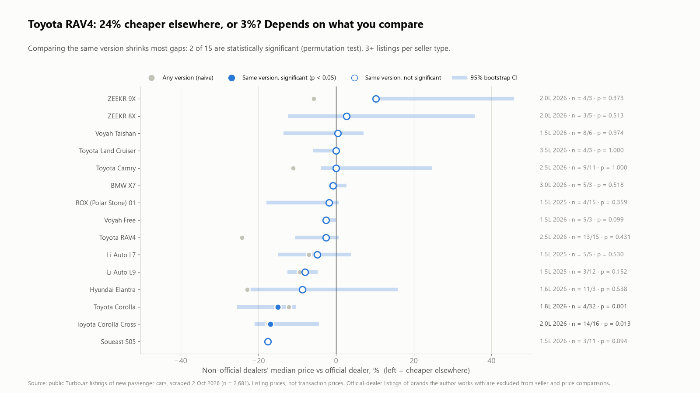
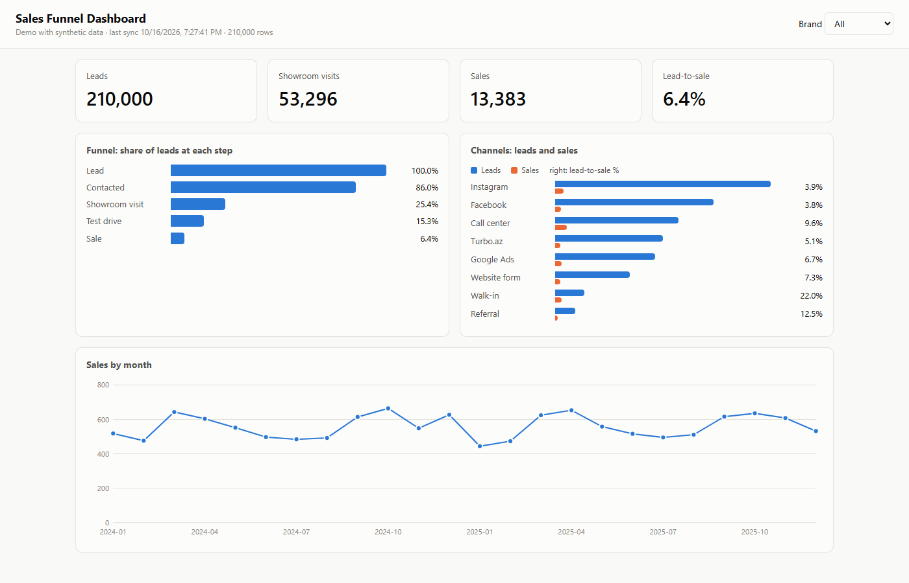
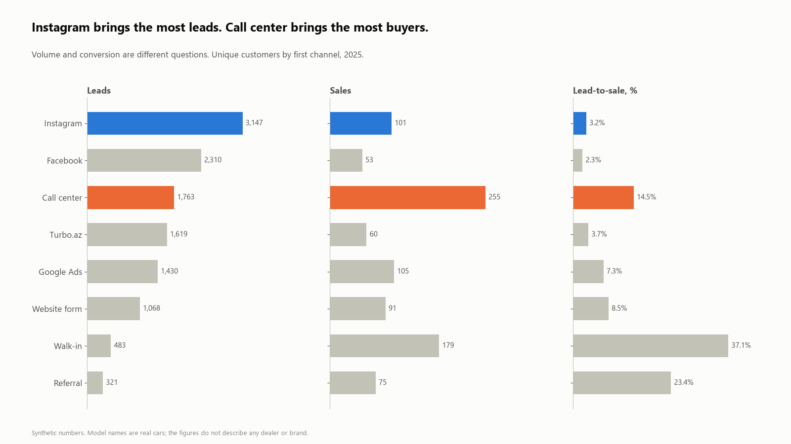
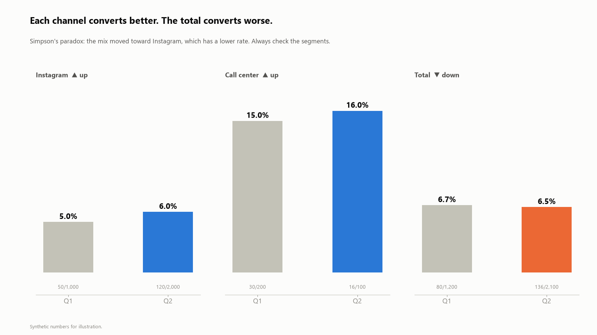

### Hi, I'm Mirkazım 👋

**Data Analyst · Marketing & Sales Analytics** · Baku, Azerbaijan

I work with marketing and sales data for 7 automotive brands: where customers drop out between the first message and the sale, which channels bring buyers (not just leads), market share, and stock against target. I also build the pipelines behind the reports, so the numbers update on their own.

---

#### Projects

| | |
|---|---|
|  | **[Azerbaijan New-Car Market](https://github.com/kazimovmirkazim/az-new-car-market)** 2,792 real Turbo.az listings: Chinese brands at 66% of the market, official vs other dealers compared like-for-like with bootstrap CIs and permutation tests (a 24% RAV4 gap shrinks to an insignificant 3%), price dispersion, paid promotion by seller type. |
|  | **[Sheets to Web Dashboard](https://github.com/kazimovmirkazim/sheets-to-web-dashboard)** Google Sheets → Apps Script → server → web dashboard. Hash-based change detection, gzip chunked upload (210K rows → 1.5 MB), atomic table swap, mobile layout. A simplified, open version of a system I run in production. |
|  | **[Car Dealer Funnel Analytics](https://github.com/kazimovmirkazim/car-dealer-funnel-analytics)** Lead-to-sale funnel, channel volume vs conversion, duplicate leads, market share in pp vs %, stock vs target. SQL (window functions, CTEs) + Python, synthetic data. |
|  | **[Marketing Stats Pitfalls](https://github.com/kazimovmirkazim/marketing-stats-pitfalls)** Five ways a correct number leads to a wrong decision: percent vs points, small samples, Simpson's paradox, mean vs median, campaign vs season. |
| | **[Turbo.az Car Price Model](https://github.com/kazimovmirkazim/Azerbaijani-car-dataset-Turboaz-dataset)** Cleaning Azerbaijani used-car listings and modelling price. |

Data is either public (Turbo.az listings, aggregated) or synthetic. No employer data is published here.

---

#### Tools

`SQL (Oracle, PostgreSQL, SQLite)` `Python (pandas, NumPy)` `Power BI` `Looker Studio` `GA4` `Excel` `Google Apps Script` `REST APIs`

#### Elsewhere

I write about statistics in plain language on [LinkedIn](https://www.linkedin.com/in/mirkazimkazimov): correlation vs causation, percent vs percentage points, why small samples mislead.
