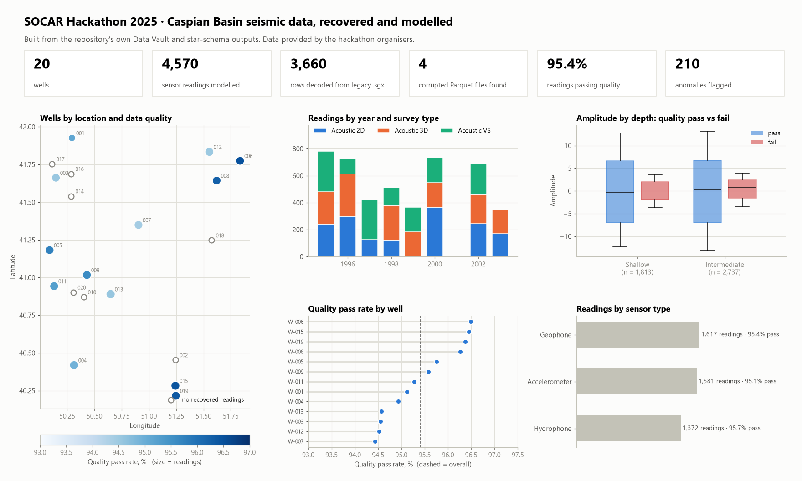
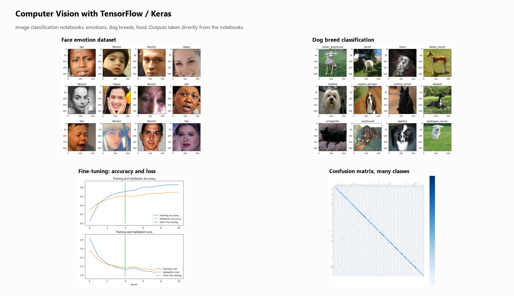
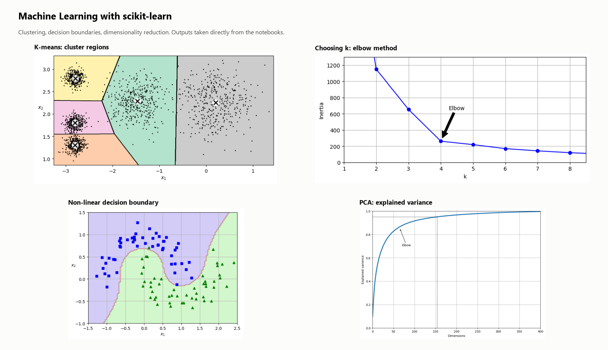

<picture>
  <source media="(prefers-color-scheme: dark)" srcset="assets/banner-dark.svg">
  
</picture>

  
  
  

I'm a data analyst in Baku. At work I analyse marketing and sales data for 7 automotive brands at SR Group. Outside of it I take part in hackathons and build machine learning and computer vision projects.

- **What I answer:** where customers drop out between the first message and the sale, which channels bring buyers and not just leads, how market share moves.
- **What I build:** the pipelines behind the reports, from raw files to a data model to a dashboard people open every day.
- **How I check:** like-for-like comparisons, confidence intervals and a look at the denominator before a number goes into a decision.

## Tools

<picture>
  <source media="(prefers-color-scheme: dark)" srcset="assets/stack-dark.svg">
  
</picture>

## Featured projects

<table>
  <tr>
    <td width="50%" valign="top">
      
      <b><a href="https://github.com/kazimovmirkazim/socar-hackathon-seismic-data-platform">SOCAR Hackathon 2025 · Seismic Data Platform</a></b> team project 
      Corrupted legacy seismic files recovered and decoded (3,660 rows from a proprietary format), modelled in Data Vault 2.0 and a star schema, then analysed: 4,570 readings, 95.4% passing quality checks.
    </td>
    <td width="50%" valign="top">
      
      <b><a href="https://github.com/kazimovmirkazim/sheets-to-web-dashboard">Sheets to Web Dashboard</a></b> 
      Open, simplified version of the dashboard platform I run at work: Apps Script sync with hash-based change detection, gzip chunked upload (210K rows → 1.5 MB), atomic table swap, mobile layout.
    </td>
  </tr>
  <tr>
    <td width="50%" valign="top">
      
      <b><a href="https://github.com/kazimovmirkazim/computer-vision-cnn">Computer Vision with CNNs</a></b> 
      Image classification in TensorFlow/Keras: face emotions, dog breeds and food, with transfer learning, fine-tuning and confusion-matrix error analysis.
    </td>
    <td width="50%" valign="top">
      
      <b><a href="https://github.com/kazimovmirkazim/az-new-car-market">Azerbaijan New-Car Market</a></b> 
      2,792 public listings analysed with bootstrap CIs and permutation tests. A 24% "cheaper elsewhere" gap shrinks to an insignificant 3% once the same version is compared.
    </td>
  </tr>
  <tr>
    <td width="50%" valign="top">
      
      <b><a href="https://github.com/kazimovmirkazim/machine-learning-notebooks">Machine Learning Notebooks</a></b> 
      scikit-learn, one concept per notebook: K-means and the elbow method, non-linear decision boundaries, PCA, random forest tuning, classification on real datasets.
    </td>
    <td width="50%" valign="top">
      
      <b><a href="https://github.com/kazimovmirkazim/neural-networks-fashion-mnist">Neural Networks · Fashion-MNIST</a></b> 
      Dense networks in TensorFlow/Keras with batch normalization and dropout, classifying 10 clothing classes.
    </td>
  </tr>
</table>

### More analytics work

| Project | What it shows |
|---|---|
| [Car Dealer Funnel Analytics](https://github.com/kazimovmirkazim/car-dealer-funnel-analytics) | Lead-to-sale funnel, duplicate leads and channel conversion in SQL with CTEs and window functions |
| [Marketing Stats Pitfalls](https://github.com/kazimovmirkazim/marketing-stats-pitfalls) | Percent vs points, small samples, Simpson's paradox, mean vs median, campaign vs season |
| [Turbo.az Car Price Prediction](https://github.com/kazimovmirkazim/turboaz-car-price-prediction) | Regex cleaning of messy listings and a scikit-learn stacking regression |
| [Deep Learning on Tabular Data](https://github.com/kazimovmirkazim/deep-learning-tabular-classification) | Multi-class Keras classifier with batch normalization and He initialization |

Project data is public or synthetic. No employer data is published here.

## How I work

| Habit | Where you can see it |
|---|---|
| Start from the decision the number will drive, not from the chart | [Sheets to Web Dashboard](https://github.com/kazimovmirkazim/sheets-to-web-dashboard) |
| Check data quality before modelling it | [SOCAR Hackathon](https://github.com/kazimovmirkazim/socar-hackathon-seismic-data-platform) |
| Compare like with like before quoting a gap | [Azerbaijan New-Car Market](https://github.com/kazimovmirkazim/az-new-car-market) |
| Small samples get an interval, not a ranking | [Marketing Stats Pitfalls](https://github.com/kazimovmirkazim/marketing-stats-pitfalls) |

## Writing

On [LinkedIn](https://www.linkedin.com/in/mirkazimkazimov) I write about statistics in plain language (in Azerbaijani): correlation vs causation, percent vs percentage points, why small samples mislead, and what a dashboard should answer.
